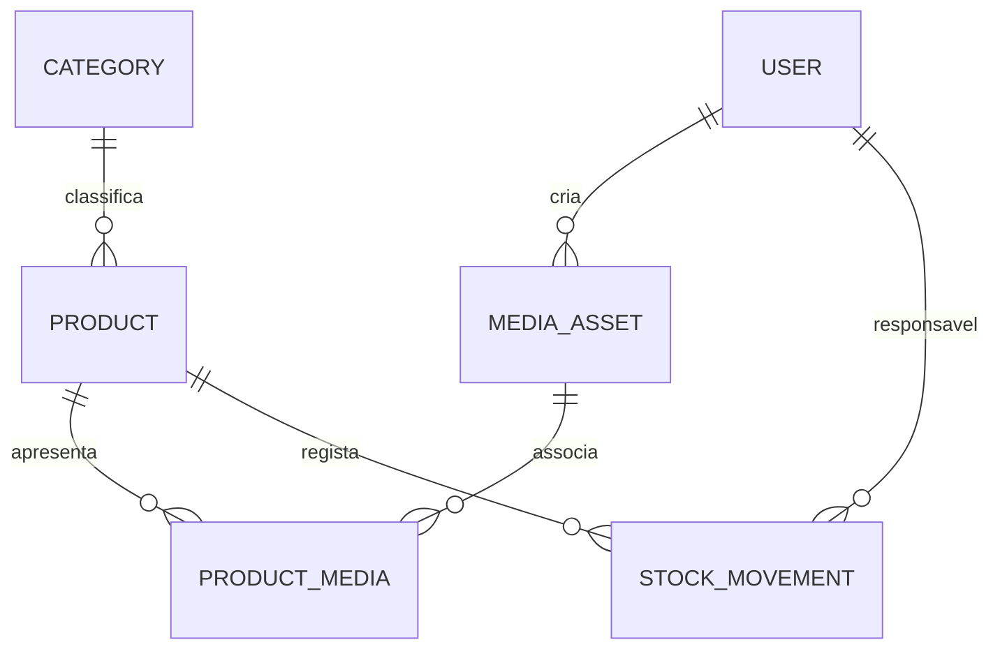

# Produtos, stock e ativos de media — estado técnico

## Estado atual

O módulo de produtos e stock tem modelos, endpoints, políticas de autorização,
validação de pedidos e testes automatizados.

As migrações de produtos, movimentos de stock e media foram executadas com
sucesso na base de teste isolada
`jdmgza_projects_manager_migration_test`.

Este resultado não confirma que as migrações tenham sido executadas nas bases
de desenvolvimento ou produção. Essas bases devem ser verificadas
separadamente antes de qualquer implantação.

A aplicação não tem, nesta fase, uma área pública de catálogo nem um fluxo
completo de upload e publicação de media.

## Modelo de dados

- `products.category_id` referencia uma categoria. A criação e a alteração
  validam que a categoria selecionada está ativa.
- `primary_image_url` é uma referência HTTPS opcional e não substitui uma
  galeria de media gerida pela aplicação.
- `stock_movements` regista movimentos de stock. A criação de um produto com
  stock inicial positivo também regista o movimento inicial.
- O ajuste de stock é realizado por um endpoint próprio, dentro de uma
  transação, com bloqueio do produto e prevenção de stock negativo.
- `media_assets` representa um ativo reutilizável, com metadados como disco,
  caminho, MIME, hash, tamanho, dimensões, visibilidade e criador.
- `product_media` associa ativos a produtos e permite guardar metadados
  editoriais, como finalidade, ordem, destaque e texto alternativo.

## Autorização

O catálogo de produtos utiliza permissões específicas:

- `products.view`
- `products.view_inactive`
- `products.create`
- `products.update`

As rotas e as políticas devem continuar alinhadas com estas permissões.
A descoberta automática de políticas do Laravel deve ser confirmada através
dos testes de autorização, sem adicionar registos manuais redundantes.

As permissões para gerir media ainda precisam de ser definidas e integradas
quando o respetivo fluxo funcional for implementado.

## Media seguro — trabalho pendente

1. Implementar o fluxo de upload e armazenamento através do Laravel Filesystem,
   com um disco privado configurável.
2. Gerar caminhos opacos no servidor; não usar o nome fornecido pelo cliente
   como caminho físico.
3. Validar o conteúdo real, os tipos MIME permitidos, o tamanho e as dimensões
   dos ficheiros.
4. Servir ficheiros privados através de autorização ou URLs temporárias
   geradas quando necessário. Não persistir URLs assinadas.
5. Separar a visibilidade do ativo do estado editorial (`draft`, `approved`,
   `published`).
6. Não obter automaticamente URLs externas sem uma estratégia de proteção
   contra SSRF, incluindo controlo de endereços IP e redirecionamentos.
7. Definir processamento assíncrono de imagens e vídeos, limites de utilização,
   limpeza de uploads incompletos e tratamento de falhas.
8. Definir auditoria, cópias de segurança, restauro e verificação de integridade
   antes de considerar o fluxo pronto para produção.

A existência das tabelas e dos modelos de media não comprova que o upload,
o armazenamento privado, a autorização de leitura ou a publicação estejam
implementados de ponta a ponta.

## Permissões de media a avaliar

- `product_media.view`
- `product_media.upload`
- `product_media.update`
- `product_media.order`
- `product_media.delete`
- `product_media.publish`

Estas permissões devem ser adicionadas ao sistema de autorização quando as
operações correspondentes forem implementadas.

A futura área pública só poderá expor ativos explicitamente autorizados para
publicação pública. O estado `approved`, por si só, não deve tornar um ativo
publicamente acessível.

## Testes e verificações pendentes

A cobertura existente inclui validação de produtos, categorias inativas,
permissões de consulta, stock inicial, entradas, saídas, devoluções e prevenção
de stock negativo.

Continuam a ser necessárias verificações específicas para:

- concorrência e consistência dos movimentos de stock;
- permissões de cada operação de produto e de consulta de movimentos;
- upload de ficheiros inválidos e validação do MIME real;
- falhas de armazenamento e limpeza de uploads incompletos;
- acesso a ficheiros privados e associação partilhada de ativos;
- estados editoriais e ausência de exposição pública não autorizada;
- implantação das migrações em cada ambiente de destino.

A aprovação dos testes automatizados não substitui uma auditoria de segurança
nem constitui, por si só, uma declaração de prontidão para produção.
